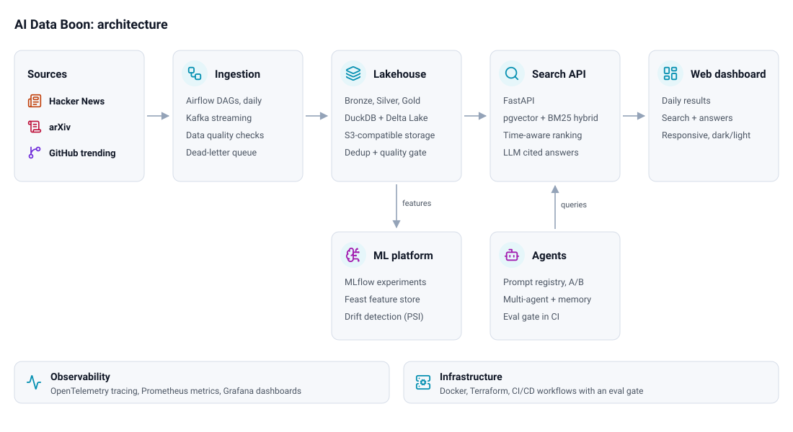

# AI Data Boon

A daily dashboard of top Hacker News stories, new arXiv papers and trending GitHub repositories, with plain-English search and short, cited answers.

**Live:** [aidataboon.com](https://aidataboon.com)

<picture>
  <source media="(prefers-color-scheme: dark)" srcset="docs/architecture-dark.svg">
  
</picture>

## Tech stack

| Layer | Technologies |
|---|---|
| Ingestion | Python, Apache Airflow, Apache Kafka |
| Lakehouse | DuckDB, Delta Lake, S3-compatible object storage |
| Search API | FastAPI, PostgreSQL + pgvector (HNSW), BM25, sentence-transformers, LLM answers |
| ML platform | MLflow, Feast, scikit-learn |
| Agents | Prompt registry with A/B rollout, multi-agent orchestration, CI eval gate |
| Observability | OpenTelemetry, Prometheus, Grafana |
| Infrastructure | Docker, Terraform, CI/CD workflows |
| Web | HTML, CSS, JavaScript |

## Quick start

```bash
uv sync
docker compose -f data_platform/01_local_stack.yml up -d   # platform stack
docker compose -f agents/01_agents_stack.yml up -d         # adds the agent API
```

Optional settings live in `data_platform/.env.example` and `agents/.env.example`. Each module also runs alone with built-in fallbacks, for example `uv run python data_platform/05_rag_service.py`.

## Layout

- `data_platform/`: ingestion, lakehouse, search API, ML platform, observability, infrastructure
- `agents/`: prompt registry, evaluation harness, multi-agent pipeline
- `frontend/`: dashboard and search UI
- `.github/workflows/`: daily ingestion, CI/CD

Design notes are in each folder's `00_project_design.md`.

## License

[MIT](LICENSE). Diagram icons from [Lucide](https://lucide.dev) (ISC).
